# Suivi mailles bota
-> Inventaire exhaustif par maille carrée

## Description
Parcours exhaustif d'un site (mailles carrées) et suivi de l'abondance des espèces cibles sur chacune d'entre elles.
### Auteur(s)
Formulaire développé par Mathieu Bossaert (CEN Occitanie)
### Objectif
Suivre de manière exhaustive (spatialement) l'abondance (A, B, C, D et E) d'une liste d'espèces végétale d'un site donné.
#### Protocole mis en œuvre
[version 2022](../fichiers/suivis_mailles_bota/Protocole_MAILLE_2022.pdf)
## Présentation détaillée
### Logique de collecte
### Captures d'écrans et/ou vidéo de démonstration

La taille de la maille carrée ainsi que la liste d'espèces sont définies en amont.

#### Paramétrage
##### Premier lancement d'ODK
-> Scanner le QRCode du projet en cliquant sur le bouton "_Configurer par QRCode_"

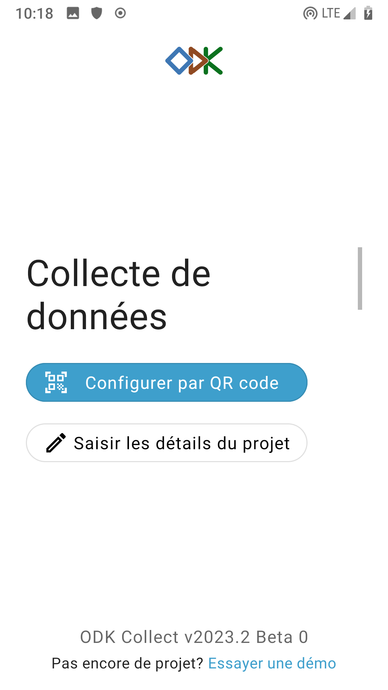

##### Accueil du projet
Voici la page d'accueil qui aparait une fois le QRCode scanné

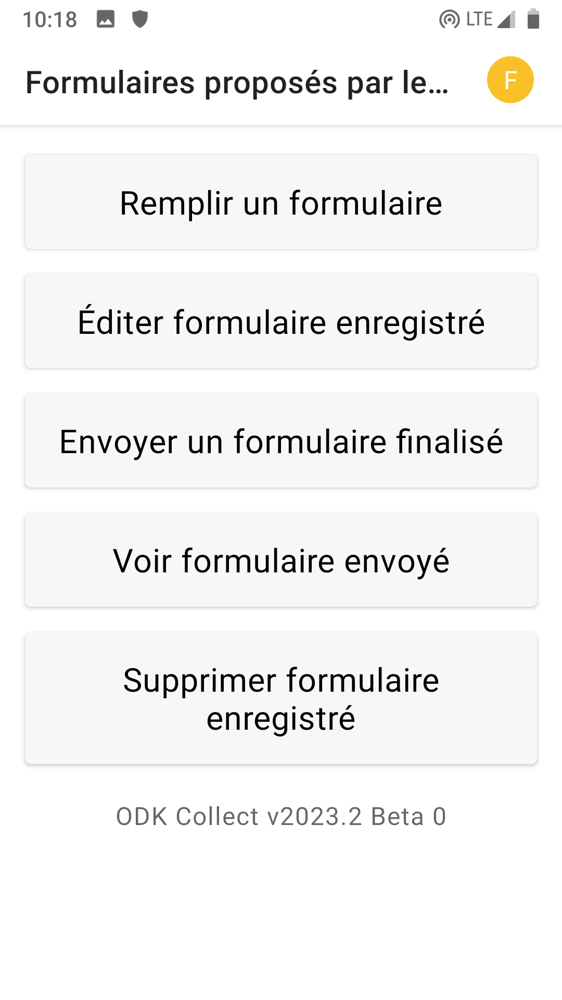

##### Paramétrage des propriétés du projet (identité de l'utilisateur et fond de carte)
Cliquer sur le rond de couleur apparaissant en haut à droite de l'écran d'ODK pour voir apparaître cette fenêtre.

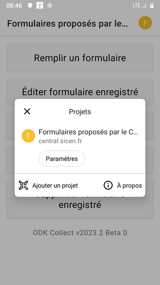

Cliquer ensuite sur "_Paramètres_"

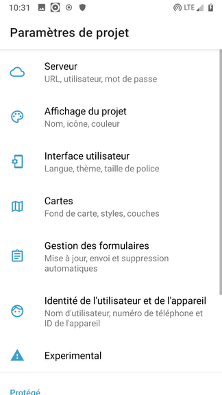

##### Renseignement des informations sur l'utilisateur
Compléter ces information permettra de ne pas avoir à les saisir lors de l’utilisation des formulaires.
Sur l'écran précédent, cliquer sur "_Identité de l'utilisateur et de l'appareil_" pour afficher l'écran ci-dessous.

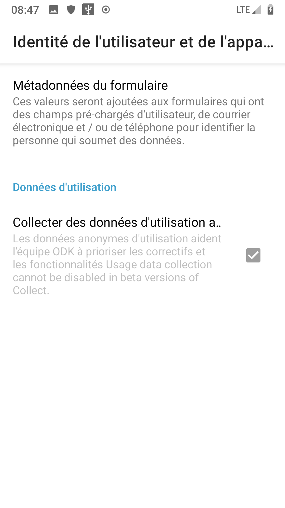

Aprés avoir chois "Métadonnées de formulaire", compléter soigneusement :
* Votre nom d'utilisateur (Prénom Nom)
* Votre adresse email professionnelle. Cette information est nécessaire pour vous attribuer correctement les données collectée.

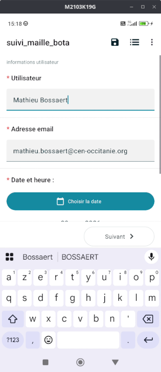

##### Choix de l'interface cartographique
Sur l'écran des paramètres de projet, cliquer sur le bouton "_Cartes_"
Choisissez le dossier de calques contenant le fond de carte de votre site.

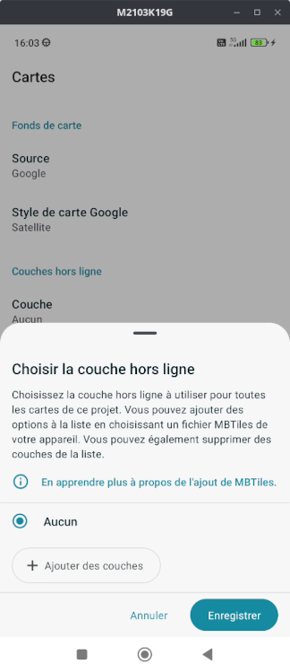

#### Utilisation du formulaire
##### Choix du formulaire "Suivi_maille_bota"

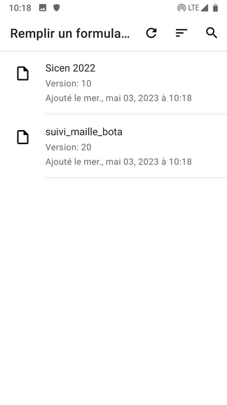

##### Renseignement de l'identité de l'utilisateur
Si vous avez correctement configuré les métadonnées du projet (cf plus haut) ces champs sont pré-rempli et vous pouvez passer au suivant.

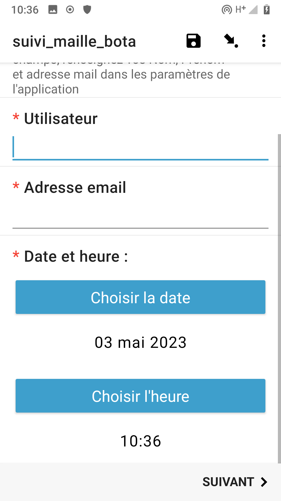

##### Choisir le site suivi au cours de cette session

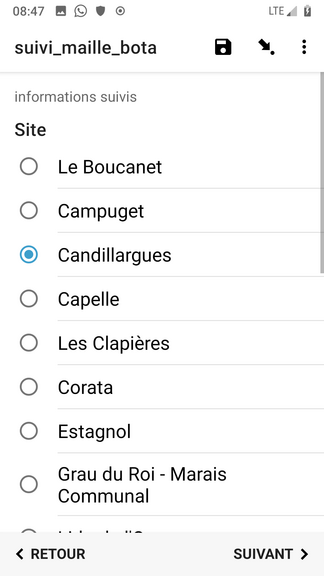

##### Choisir le protocole

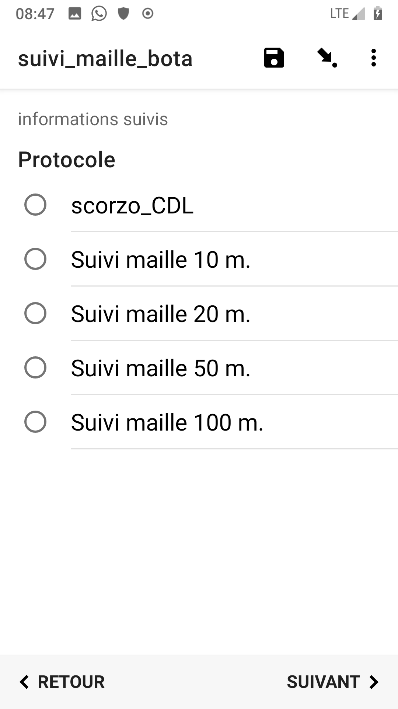

##### Choix de la méthode de cartographie
Soit vous utilisez un fond statiques (les mailles sont dessinées sur le fond de carte en amont) et vous créez alors des points au dessus de ce fonds de carte,
soit vous utilisez un référentiel de mailles cliquables.

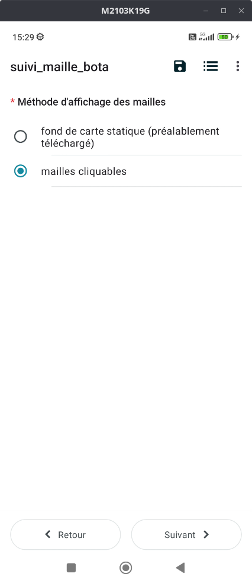

##### Démarrer la localisation

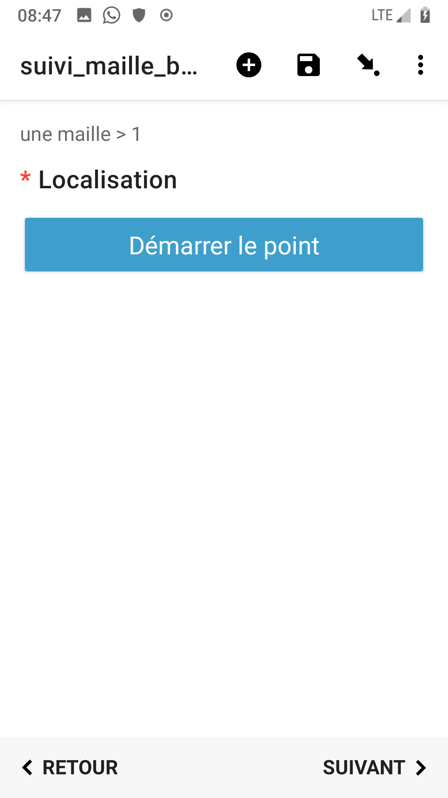

-> ODK vous place à l'endroit du GPS

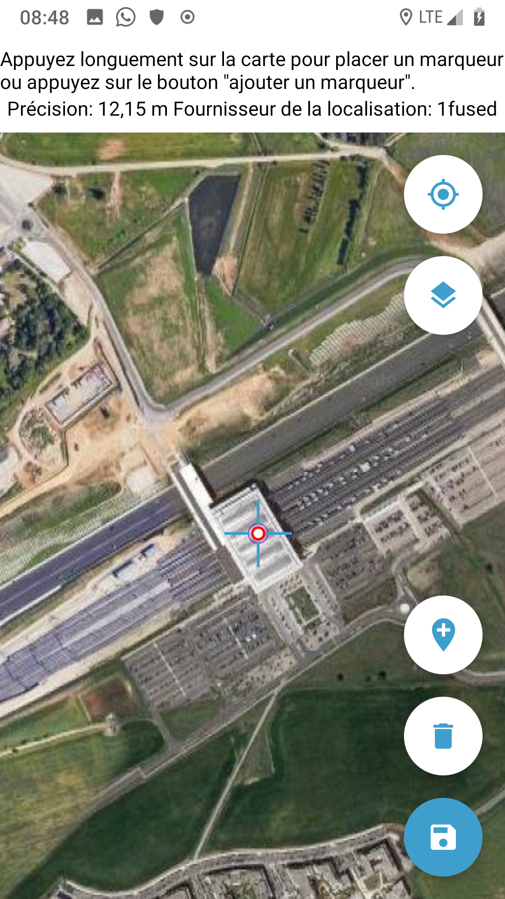

> /!\ Depuis 2025, il est possible de choisir la maille dans laquelle on se trouve en choisissant la méthode "mailles cliquables".
Les mailles sont à créer en amont dans le fichier [mailles_4326.geojson](../fichiers/suivis_mailles_bota/mailles_4326.geojson.zip).
Le fichier xlsform présenté plus bas propose cette fonctionnalité.

##### Méthode de pointage sur image de fond présentant les grilles

-> Afficher votre fond de carte (en lieu et place de celui par défaut)

1. Cliquer sur l’icône représentant les couches
2. Choisissez votre fond de carte

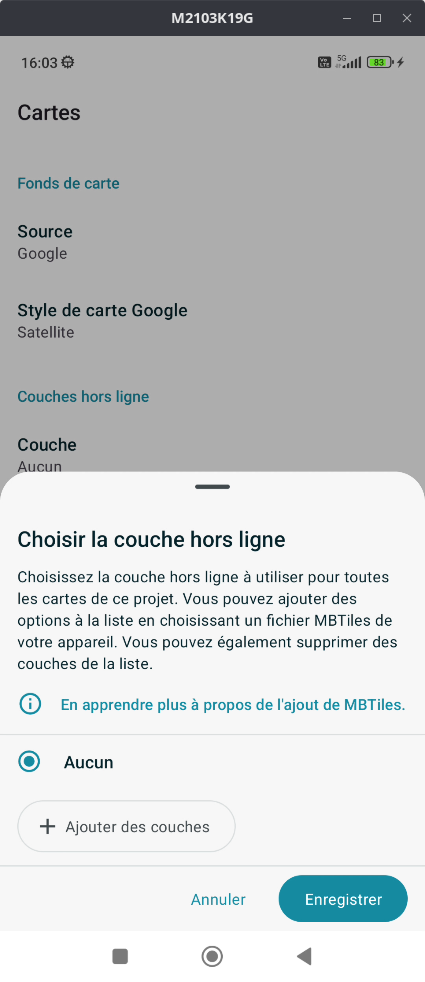

3. Créez votre point

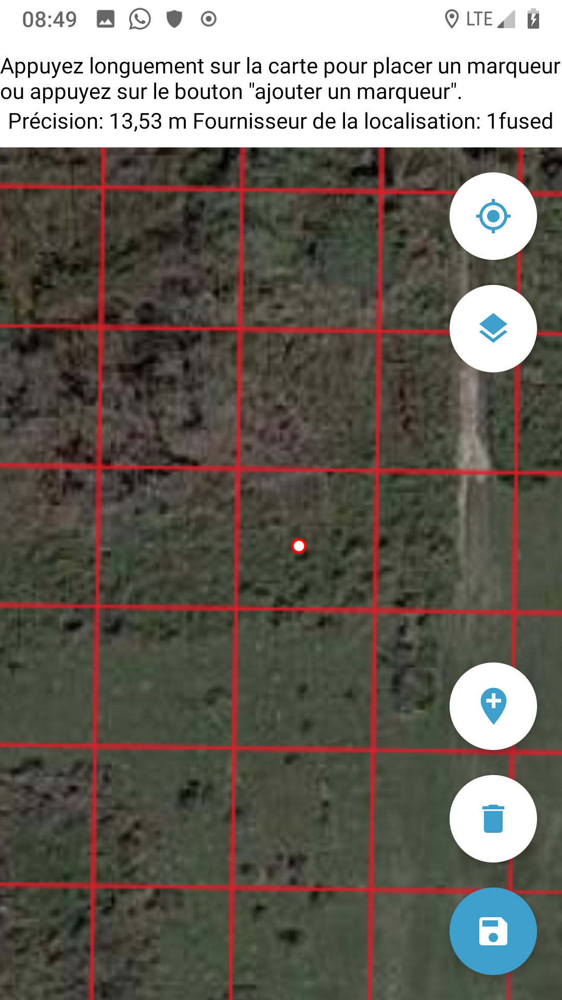

4. Valider la localité

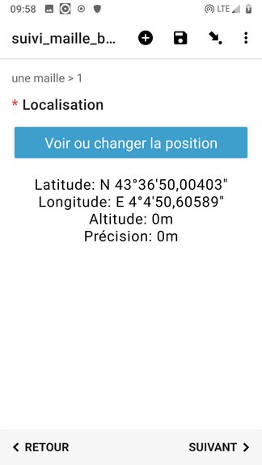

##### Méthode de pointage sur grille cliquable
-> Selectionnez la maille dans laquelle vous place le GPS
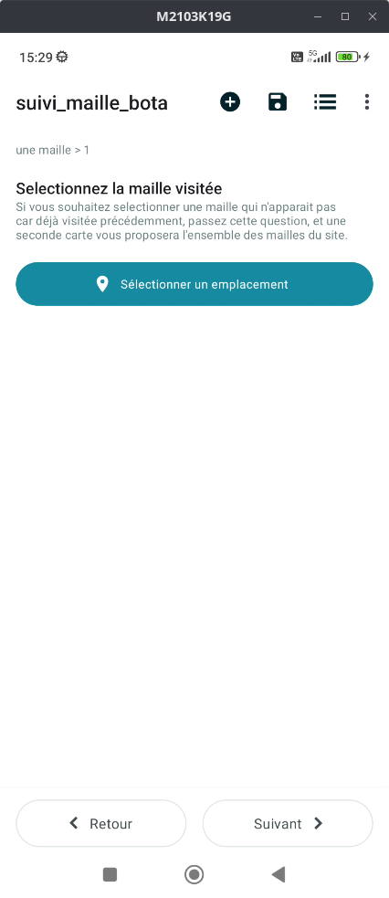

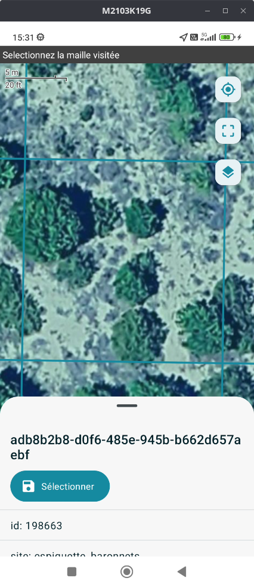


##### Renseignement de l'abondance de la ou des espèces (selon les sites)

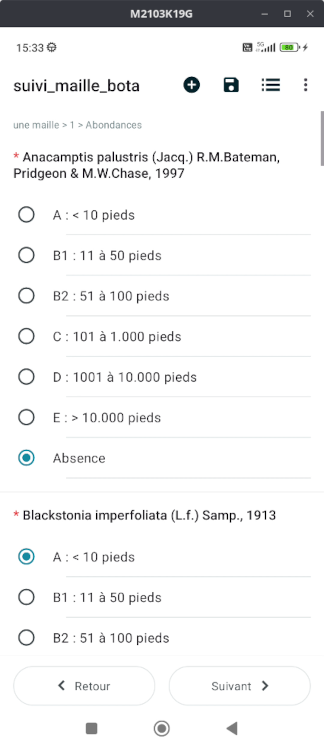

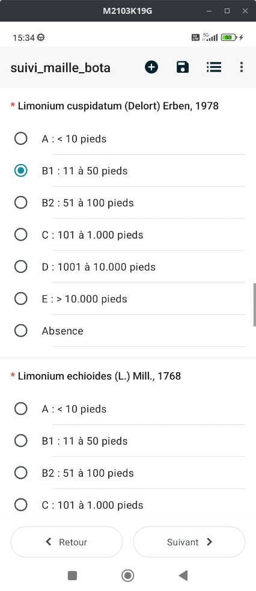


##### Ajouter une nouvelle maille / localité ou terminer le formulaire

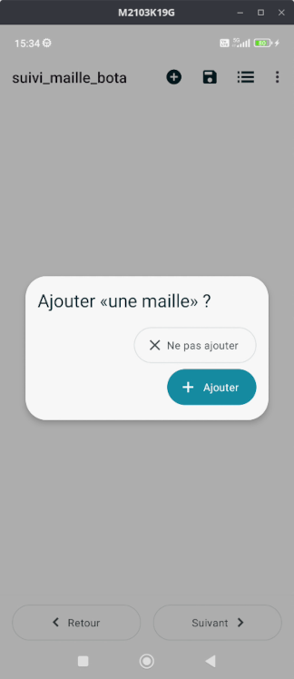

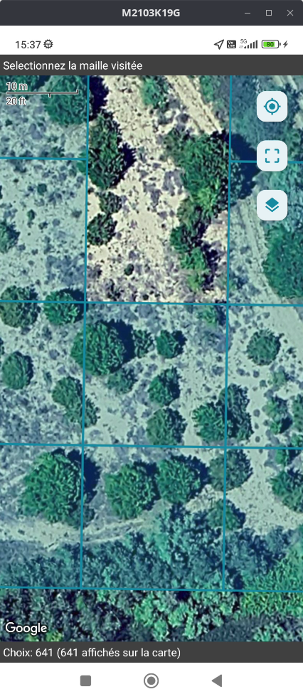

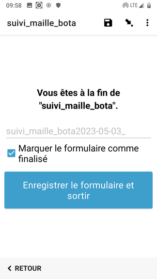

### Perspectives
* Disposer d'un formulaire plus générique ne générant pas autant de questions que d'espèces suivies, pour la forme en base de données.

## Utiliser ce formulaire
### Licence
[](https://creativecommons.org/licenses/by/2.0/fr/)
### XLSform
* [xlsform](../fichiers/suivis_mailles_bota/suivi_maille_bota.xlsx)
### Données externes et médias associés
-> liens vers les ressources

## Fonctionnalités de XLSForm mises en œuvre
### Discussion en ligne sur le forum d'ODK

## Traitement des données
### Scripts SQL
```sql
 WITH mailles_espece_possibles AS (
         SELECT DISTINCT mailles.gid,
            taxref.nom_valide,
            taxref.cd_ref,
            mailles.geometrie AS geom
           FROM inpn.mailles_20m mailles
             JOIN inpn.taxref ON true
             JOIN inpn.perimetre_etude_pour_creation_grille site ON st_intersects(site.geometrie, mailles.geometrie)
          WHERE (site.id_perim = ANY (ARRAY[88, 260])) AND (taxref.cd_ref = ANY (ARRAY['110207'::text]))
        ), obs_ref AS (
         SELECT mailles.gid,
            taxref.cd_ref,
            COALESCE(date_part('year'::text, saisie_observation.date_obs)::text, "right"(saisie_observation.date_text::text, 4))::integer AS annee_obs,
            upper(COALESCE(
                CASE
                    WHEN saisie_observation.effectif < 11 THEN 'A'::text
                    WHEN saisie_observation.effectif < 51 THEN 'B1'::text
                    WHEN saisie_observation.effectif < 101 THEN 'B2'::text
                    WHEN saisie_observation.effectif < 1001 THEN 'C'::text
                    WHEN saisie_observation.effectif > 1000 THEN 'D'::text
                    ELSE NULL::text
                END,
                CASE
                    WHEN saisie_observation.type_eff ~~* 'pr%'::text THEN 'A'::text
                    WHEN saisie_observation.eff_text ~~* 'pr%'::text THEN 'A'::text
                    ELSE split_part(saisie_observation.eff_text, ';'::text, 1)
                END, 'A'::text)) AS effectif_textuel,
            saisie_observation.protocole,
            saisie_observation.remarque
           FROM export.tous_point_espece_format_esri saisie_observation
             JOIN inpn.taxref ON saisie_observation.cd_ref::text = taxref.cd_nom
             JOIN inpn.perimetre_etude_pour_creation_grille site ON st_intersects(site.geometrie, saisie_observation.geometrie)
             JOIN inpn.mailles_20m mailles ON st_intersects(mailles.geometrie, saisie_observation.geometrie)
          WHERE (site.id_perim = ANY (ARRAY[88, 260])) AND (taxref.cd_ref = ANY (ARRAY['110207'::text])) AND saisie_observation.protocole ~~* '%maille%'::text
          ORDER BY (COALESCE(date_part('year'::text, saisie_observation.date_obs)::text, "right"(saisie_observation.date_text::text, 4))::integer)
        )
 SELECT row_number() OVER () AS gid,
    EXTRACT(year FROM now()) AS annee_ref,
    mailles_espece_possibles.nom_valide,
    mailles_espece_possibles.cd_ref,
    st_x(st_transform(st_centroid(mailles_espece_possibles.geom), 4326)) AS lon,
    st_y(st_transform(st_centroid(mailles_espece_possibles.geom), 4326)) AS lat,
    st_centroid(mailles_espece_possibles.geom) AS centroid,
    mailles_espece_possibles.geom AS geometrie,
    COALESCE(max(obs_ref.effectif_textuel) FILTER (WHERE obs_ref.annee_obs::double precision < EXTRACT(year FROM now())::double precision), 'absence'::text) AS "avant année de référence",
        CASE COALESCE(max(obs_ref.effectif_textuel) FILTER (WHERE obs_ref.annee_obs::double precision < EXTRACT(year FROM now())::double precision), 'absence'::text)
            WHEN 'A'::text THEN 1
            WHEN 'B'::text THEN 11
            WHEN 'B1'::text THEN 11
            WHEN 'B2'::text THEN 51
            WHEN 'C'::text THEN 101
            WHEN 'D'::text THEN 1001
            ELSE 0
        END AS "effectif avant année de référence",
    COALESCE(max(obs_ref.effectif_textuel) FILTER (WHERE obs_ref.annee_obs::double precision = EXTRACT(year FROM now())::double precision), 'absence'::text) AS "durant année de référence",
        CASE COALESCE(max(obs_ref.effectif_textuel) FILTER (WHERE obs_ref.annee_obs::double precision >= EXTRACT(year FROM now())::double precision), 'absence'::text)
            WHEN 'A'::text THEN 1
            WHEN 'B'::text THEN 11
            WHEN 'B1'::text THEN 11
            WHEN 'B2'::text THEN 51
            WHEN 'C'::text THEN 101
            WHEN 'D'::text THEN 1001
            ELSE 0
        END AS "effectif à partir de extract(YEAR FROM now())",
        CASE
            WHEN upper(max(obs_ref.effectif_textuel) FILTER (WHERE obs_ref.annee_obs::double precision < EXTRACT(year FROM now())::double precision)) IS NULL AND upper(max(obs_ref.effectif_textuel) FILTER (WHERE obs_ref.annee_obs::double precision >= EXTRACT(year FROM now())::double precision)) IS NOT NULL THEN 'apparition'::text
            WHEN upper(max(obs_ref.effectif_textuel) FILTER (WHERE obs_ref.annee_obs::double precision < EXTRACT(year FROM now())::double precision)) IS NOT NULL AND upper(max(obs_ref.effectif_textuel) FILTER (WHERE obs_ref.annee_obs::double precision >= EXTRACT(year FROM now())::double precision)) IS NULL THEN 'disparition'::text
            WHEN upper(max(obs_ref.effectif_textuel) FILTER (WHERE obs_ref.annee_obs::double precision < EXTRACT(year FROM now())::double precision)) IS NULL AND upper(max(obs_ref.effectif_textuel) FILTER (WHERE obs_ref.annee_obs::double precision >= EXTRACT(year FROM now())::double precision)) IS NULL THEN 'absence répétée'::text
            WHEN COALESCE(upper(max(obs_ref.effectif_textuel) FILTER (WHERE obs_ref.annee_obs::double precision < EXTRACT(year FROM now())::double precision)), '0'::text) > COALESCE(upper(max(obs_ref.effectif_textuel) FILTER (WHERE obs_ref.annee_obs::double precision >= EXTRACT(year FROM now())::double precision)), '0'::text) THEN 'maintien/diminution'::text
            ELSE 'maintien/augmentation'::text
        END AS evolution
   FROM mailles_espece_possibles
     JOIN obs_ref USING (gid, cd_ref)
  GROUP BY mailles_espece_possibles.gid, mailles_espece_possibles.nom_valide, mailles_espece_possibles.cd_ref, mailles_espece_possibles.geom
```

### Scripts R
### Autres

Une carte de restitution :


